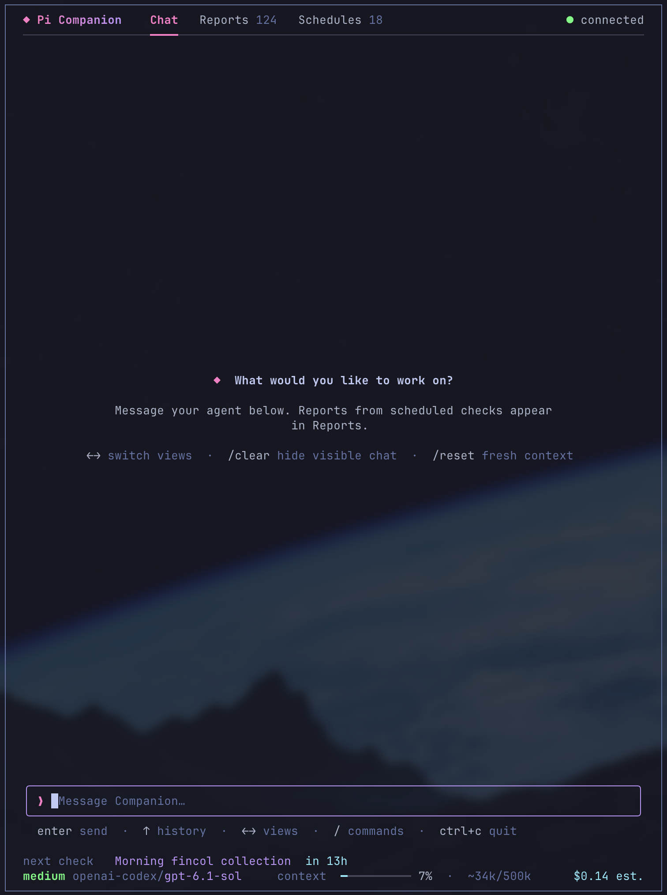

# Pi Companion

Companion runs scheduled checks through Pi and saves their results as Markdown reports. Chat with the agent, watch checks as they run, and read completed reports in the terminal.



## Run it

Run from a checkout containing the standalone CLI:

```sh
pnpm install
pnpm pi-companion
```

You need Node 22.19 or newer, pnpm, configured Pi credentials and `pi` on PATH. This checkout uses Pi SDK/TUI 1.4.0. If `pi-companion` is already on PATH, launch it from any directory:

```sh
pi-companion
```

First launch creates `~/.companion` and connects Pi without sending a model request. Later launches reopen the same conversation. Use `--home /absolute/path` or `COMPANION_HOME` for another workspace.

Companion uses your ordinary Pi tools, extensions, MCP servers and project context. Models configured in Pi, including Anthropic/Claude models, work here. Pi's own screens and custom extension widgets are not reproduced.

Already using Companion? Read the [CLI update steps](docs/upgrade.md#already-using-the-cli) or the [legacy migration steps](docs/upgrade.md#legacy-pi-extension-before-planning). Opening a new workspace never imports old data or disables the old extension.

## Use it

Chat opens ready to type. Reports holds completed checks; Schedules shows their next run and any configuration errors. Running checks get their own read-only tabs. Finishing the selected check opens its report.

- **Enter** sends a message or opens the selected report.
- **Left/Right** changes views when the chat draft is empty; otherwise it moves the cursor.
- **Arrow keys** select reports. **Page Up/Down** and the mouse wheel scroll.
- **m** inside a report moves to the composer with that report attached, so you can ask about it and carry on in Chat. **Escape** in the composer drops the report and keeps your draft.
- **Escape** leaves a report or returns to Chat without losing the draft.
- **k** cancels the selected running check. Jobs have no automatic execution deadline.
- **Ctrl+C** quits.

Type `/` to see local commands. `/clear` hides visible chat without deleting history or changing model context. `/reset` starts a fresh conversation and resets the displayed cost estimate; old transcripts, usage history and background work remain. Pi's editor shortcuts and configured editor keybindings work in the composer.

Colors follow Pi's saved theme. The header shows connection state; the status bar shows the next check, the total size of Companion's memory files, model, context usage and estimated cost. Critical and useful report summaries appear in Chat; no-news reports stay in Reports. Occasional tips appear above the shortcuts.

Ask the agent to run a configured check now, even if its recurring schedule is paused. This runs it once without changing its schedule.

Ask the agent for a different model or thinking effort and the conversation switches on its next model call, with no restart. Each schedule has its own model and effort, and its reports use them: name a check to change only that one, and its next run picks it up. Schedules shows each check's effort.

Companion notices which reports you open or message about. A check is flagged in Schedules, and mentioned in tips, when at most 1 in 5 of its latest reports was, across at least 5 reports and a week of tracking, with no critical finding and no run you requested. Nothing changes on its own: ask the agent to revisit a flagged check. This stays in the data folder as run IDs and timings in `runtime/telemetry.jsonl` and a per-check summary in `runtime/report-attention.json`, and a summary you only read in Chat does not show up.

The agent keeps a short list of what matters right now in `memory.md` in the data folder: up to 20 one-line items that it adds, updates and removes as things change. Ask it to remember or forget something, or edit the file yourself. The list stays within Companion, chat sees it on every turn, and scheduled checks can read it but not change it.

Each check also keeps its own folder at `~/.companion/checks/<id>/`, and every run starts with both files in it. `memory.md` is the check's working memory: checkpoints, open items and what it has already reported. Its agent maintains the file, and you can edit it too. `log.md` has one line per run, written by Companion, with the time, trigger, outcome, duration, cost and first report line.

A check that cannot do its work says `Blocked:` in Chat. After two blocked or failed runs in a row, Companion stops scheduling it instead of retrying: Schedules shows it as held, and it tries again after 1 day, then 2, 4 and 7. A working run or a schedule edit clears the hold, and you can still run it on request.

## Add a schedule

Create a Markdown file in `~/.companion/schedules/daily/`, `weekly/` or `monthly/`:

```markdown
---
{
  "id": "morning-recap",
  "title": "Morning recap",
  "at": "09:00",
  "timezone": "America/Sao_Paulo",
  "enabled": false,
  "harness": "pi",
  "model": "provider/model",
  "effort": "medium",
  "cwd": "/absolute/project/path",
  "context": ["notes/current.md"]
}
---
Check the approved notes for changes worth acting on. Cite the evidence.
```

Set your paths, timezone and model, then enable the file. `model: null` uses Pi's default. Weekly files take a `weekday`, or a list such as `[1, 2, 3, 4, 5]` for Monday to Friday.

For a check that runs once, put the file in `once/` with a `date` (`YYYY-MM-DD` in the file's timezone) plus `at` or `window`. If Companion was not running at that time, the check runs as soon as it is, however late. It never runs twice and then shows as done. The [schedule guide](src/prompts/schedule-setup.md) covers multiple daily times, hourly windows and weekly/monthly settings. Companion reloads edited schedules automatically. Keep the dashboard or headless runner open for checks to run.

## Start Pi through a launcher

If Pi must start through a wrapper, for example one that sets up credentials or required extensions, add `launcher` to Companion's `config.json`:

```json
"launcher": { "command": ["my-pi-launcher", "pi"], "env": { "EXAMPLE_MODE": "1" }, "managedExtensions": true }
```

Companion then starts every Pi process with that command. The main chat runs as an RPC child (`my-pi-launcher pi --mode rpc`), and checks, reflection, pattern review and repair use the same command. `env` adds variables and rejects credential-like names. Companion passes its own environment through and never reads credentials. Set `managedExtensions` when the launcher loads required extensions and refuses `--no-extensions`. Tool-free jobs then keep their other isolation flags. If the main chat's child exits, Companion says so and keeps running scheduled checks; restart it to reconnect the chat. Without `launcher`, Companion runs `pi` directly, as before.

## Use it from other agents

`pi-companion skill` prints a skill that teaches an agent to read reports and run history, add checks, queue one-time work and stay out of Companion's internals. Read it directly, or save it where your agent loads skills:

```sh
mkdir -p ~/.pi/agent/skills/pi-companion
pi-companion skill > ~/.pi/agent/skills/pi-companion/SKILL.md
```

## Run without the dashboard

`pi-companion run` runs in the foreground for your supervisor to manage. Companion does not install a service. Only one runner can own a workspace.

These commands read saved state without starting Pi or schedules:

```sh
pi-companion status --plain
pi-companion schedules
pi-companion history
```

After a crash, unfinished work is marked interrupted rather than retried. A stale owner lock can take up to five minutes to expire; do not delete a live owner's lock. Costs are estimates, not invoices. See [architecture and recovery details](docs/v2-design.md).

To find recurring work in selected past sessions, use the optional [session review](src/prompts/session-patterns-setup.md). For `/companion` inside Pi, see the [legacy guide](docs/legacy.md). Migration instructions include an [agent checklist](docs/upgrade.md#agent-checklist).
